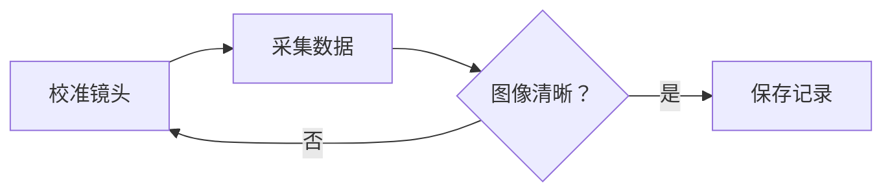

本地测试文章。建议从这篇开始检查真实博客阅读页，测试章节目录、排版设置、选区分享和上下篇导航。

## 观测日志

夜间记录包含 **粗体**、*斜体*、~~旧读数~~、==重点==、`sensor.read()` 和 {星図|せいず}。这段文字可用于选区复制、站内搜索和生成分享卡片。

> 同一段观测记录可以同时记录地点、时间和设备状态。[^log]

> [!NOTE] 设备检查
> 先确认镜头是否结露，再检查遮光罩的位置。

> [!TIP]- 折叠的校准步骤
> 展开后应显示两项内容。
>
> - 将望远镜转回零位。
> - 清除前一晚的校准偏移。

- [x] 时间同步
- [/] 曝光测试
- [ ] 备份底片
- [?] 确认第二台相机

## 图像与表格

![[/assets/images/banners/observatory.jpg|观测站外景|center|65%]]


| 记录项目 | 仪器与环境 | 读数或备注 |
| --- | --- | ---: |
| 环境温度 | 气象箱，北侧平台 | 12.4 °C |
| 镜头读数 | 备用镜组，手动校准，连续拍摄后的热稳定状态 | 18.2 °C |
| 云层 | 东南方向积云与西南方向低云 | 3/8 |

## 代码、公式与流程图

```js
const readings = [12.4, 12.6, 12.8];
const average = readings.reduce((sum, reading) => sum + reading, 0) / readings.length;
console.log(average.toFixed(1));
```

行内公式 $E = mc^2$ 与正文对齐。平均值也可以写成块级公式。

$$
\bar{x} = \frac{1}{n}\sum_{i=1}^{n} x_i
$$



## 聊天、动态与链接

> [!chat] **观测值班组** · 在线
>
> > **值班员** 20:00 · 已送达
> > 暮色已落，正在准备 **第一组曝光**。
>
> > **记录员** 20:01 · 已读
> > 收到，先拍一张测试底片。

> [!moment] **记录员** · 20:15 · 观测台
>
> 第一组星图已归档。云层比预计的薄，今晚还可以多做一次观测。
>
> ❤️ 3 · 💬 1

[[blog-demo-reader|打开长文阅读示例]]

https://github.com/vuejs/core

回到 [[#观测日志|观测日志]]，或打开[博客列表](/blog)检查返回导航。

[^log]: 点击脚注编号跳到这里，再用返回链接回到正文。
